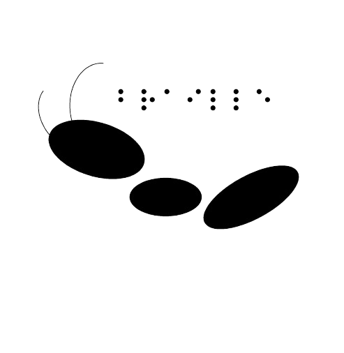

# 🙏 Thanks
## This project exists thanks to the support, collaboration, and tools provided by many people and communities.
### My sincere appreciation goes to:
### Developers Who Came Before
- For building the foundations, tools, and knowledge that allow new accessibility technologies to exist today.
### João Victor Nagao
- For contributing to the development of new accessibility tools and helping expand the possibilities of this project.
### Koyama Rumi
- For helping with the marketing and presentation of the tool.
### Nagao Yuji
- For creating and maintaining BrailleBase, designing its architecture, and developing its core features with a focus on accessibility and education.

### Font Base
        https://www.pharmabraille.com/pharmaceutical-braille/the-braille-alphabet/
        https://iceb.org/wp-content/uploads/2025/10/Rules-of-Unified-English-Braille-2024.pdf
        https://brailleaustralia.org/wp-content/uploads/2025/02/Rules-of-Unified-English-Braille-2024-1.pdf
        https://www.brailleauthority.org/alphabet/alphabet.pdf
        https://www.brailleart.org/pdf/Brailleart-Braille-Alphabet-English-Language-Letter.pdf
        https://braillecomicsclub.substack.com/p/the-unified-english-braille-alphabet
        https://braille.codes/tables.html
        https://www.edvisionservices.org/Formsupdated/PDFForms/UEB_chart_and_reference_guide.pdf
        https://chinhphu.vn/default.aspx?pageid=27160&docid=198030

